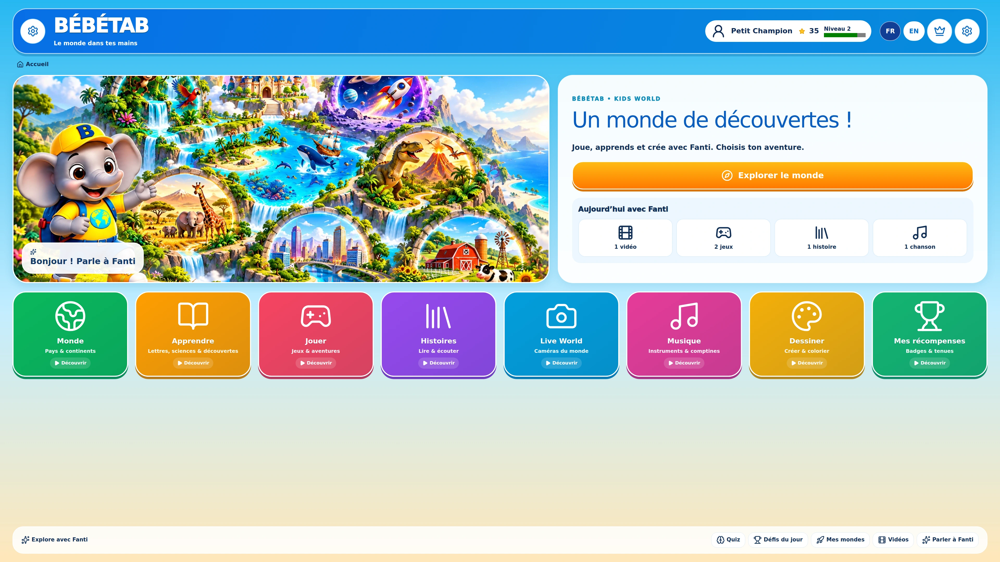

# Captures UHD

Les 19 captures `uhd/*.webp` proviennent de l’application interactive à une taille de viewport de **3840 × 2160**. Leur encodage WebP conserve ces dimensions. Les illustrations source de Fanti sont en **1672 × 941**, avec une interface et des icônes vectorielles indépendantes.

Voir [le catalogue des écrans](../docs/SCREENS.md). Les captures présentent des données de test locales.

## Références visuelles actuelles — 31 octobre 2026

Fanti est l’éléphanteau gris-bleu du projet. Les illustrations montrant l’ancien caméléon sont retirées des références actives.

- [Nouveau parcours Sciences](https://drive.google.com/file/d/1yHq4R9jDYMh7Hr_1H_gMAhL4APf2kKUl/view)
- [Lecteur d’histoire avec sous-titres](https://drive.google.com/file/d/1v5iOr3uoOfivTsbzWokhwTYXcZFCaahi/view)
- [Contrôles parents et sélection de vidéos](https://drive.google.com/file/d/15kauvt8scmKCQhVE6SuphLD66dR1lx2s/view)
- [Dossier complet des créations BEBETAB dans Drive](https://drive.google.com/drive/folders/1w_6X18XZGjLAwLIiVlEBXGEMqCBwd5qB)

Ces images sont les références d’interface pour les prochains écrans natifs. Le contenu interactif et les textes restent rendus par l’application.
